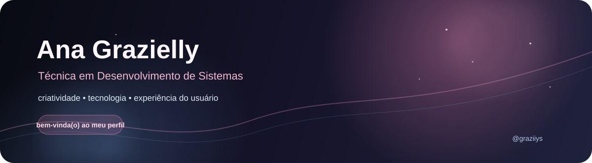
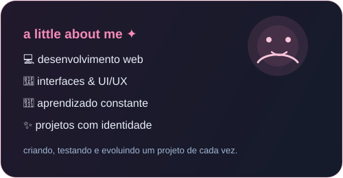

 

  

 

<table>
<tr>
<td width="60%" valign="top">

## Oiii! Eu sou a Ana Grazielly ♡

Sou **Técnica em Desenvolvimento de Sistemas** e gosto de transformar ideias em experiências digitais bonitas, funcionais e fáceis de usar.

Tenho interesse principalmente por **desenvolvimento web, interfaces, criatividade e experiência do usuário**. Gosto de aprender colocando a mão na massa e criando projetos que tenham personalidade.

 

### ✦ Atualmente

- 💻 Criando projetos para praticar desenvolvimento web
- 🎨 Explorando UI/UX e experiências interativas
- 🌱 Aprendendo e aperfeiçoando JavaScript e Python
- 🚀 Construindo meu portfólio e meu repertório profissional

</td>
<td width="40%" align="center" valign="middle">

</td>
</tr>
</table>

 

## ♡ Tecnologias que fazem parte da minha jornada

  

 

## 📊 GitHub em números

 

 

## ✿ Meus projetos

<table>
<tr>
<td width="50%" valign="top">

### 💻 Portfólio pessoal

Meu espaço para apresentar minha trajetória, projetos, habilidades e experiências na área de tecnologia.

<a href="https://github.com/graziiys">↗ Ver no GitHub</a>

</td>
<td width="50%" valign="top">

### ✓ FlowTask

Conceito de sistema de gestão de tarefas e projetos, pensado para unir organização, praticidade e uma interface agradável.

<a href="https://github.com/graziiys">↗ Ver projetos</a>

</td>
</tr>
<tr>
<td width="50%" valign="top">

### ♫ VIBE

Conceito de experiência musical interativa, explorando biblioteca de músicas, descoberta de conteúdo e identidade visual.

<a href="https://github.com/graziiys">↗ Ver projetos</a>

</td>
<td width="50%" valign="top">

### 🌐 Inglês Quente

Projeto desenvolvido para integrar conteúdo de inglês com tecnologia, utilizando a construção de uma experiência web.

<a href="https://github.com/graziiys">↗ Ver no GitHub</a>

</td>
</tr>
</table>

 

## 🌱 O que estou estudando

`HTML` &nbsp; `CSS` &nbsp; `JavaScript` &nbsp; `Python` &nbsp; `UI/UX` &nbsp; `Git & GitHub`

 

## 📈 Minha atividade

 

### ♡ obrigada por visitar meu perfil!

Se você gosta de tecnologia, criatividade e projetos que saem do papel, fique à vontade para acompanhar minha jornada.

 

  

feito com ♡, código e curiosidade.

